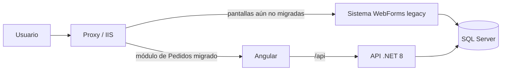
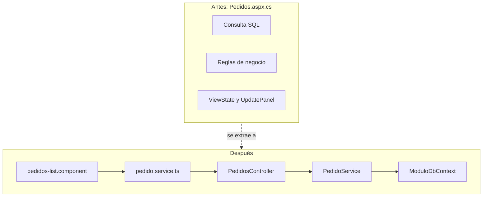

# Arquitectura y estrategia de migración (strangler fig)

La migración no reemplaza el sistema de un día para otro: la nueva solución "estrangula" al sistema WebForms pantalla por pantalla, mientras ambos conviven.

## Fase 1 — Convivencia

Ambos sistemas comparten la base de datos. El módulo de Pedidos se redirige a Angular; el resto sigue en WebForms.

## Fase 2 — Reglas de negocio fuera de la página

## Orden recomendado de migración

1. **Exponer la lógica de negocio como servicios** (`PedidoService`, `PedidosController`) sin tocar la UI.
2. **Migrar la capa de datos** a EF Core (`ModuloDbContext`), apuntando a la misma base de datos.
3. **Autenticación JWT**, reutilizando el esquema de contraseñas del sistema legacy.
4. **Angular**: reemplazar controles WebForms por componentes, y `ViewState`/`Session` por estado con RxJS.
5. **Pruebas**: cubrir primero las reglas de negocio (aprobación, descuentos) antes de apagar la pantalla vieja.
6. **Apagar la pantalla WebForms** cuando la nueva lleve un tiempo estable en producción.
